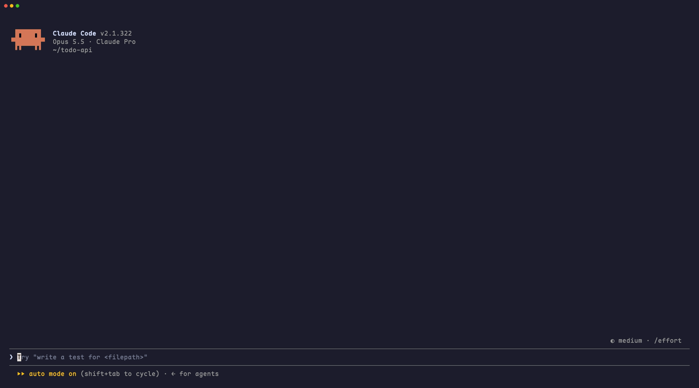
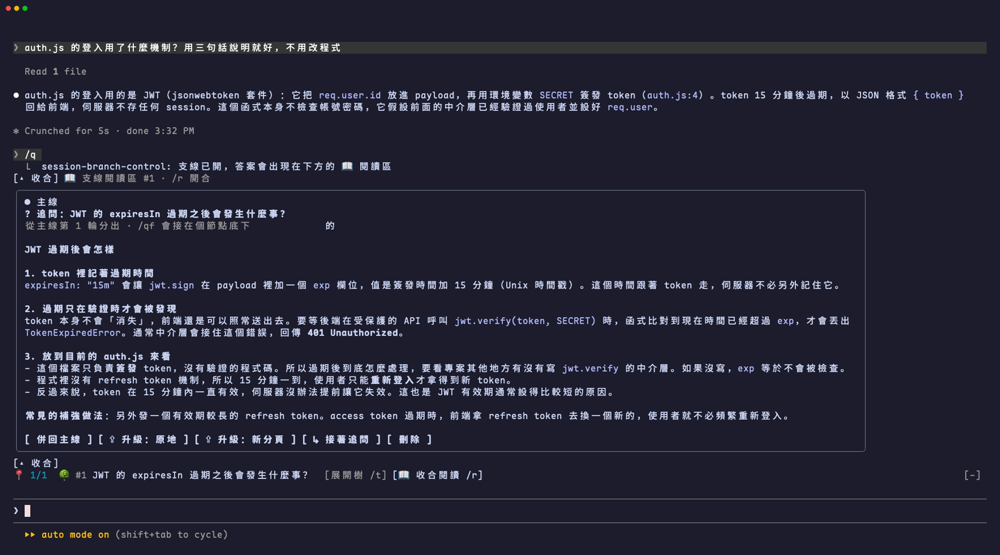
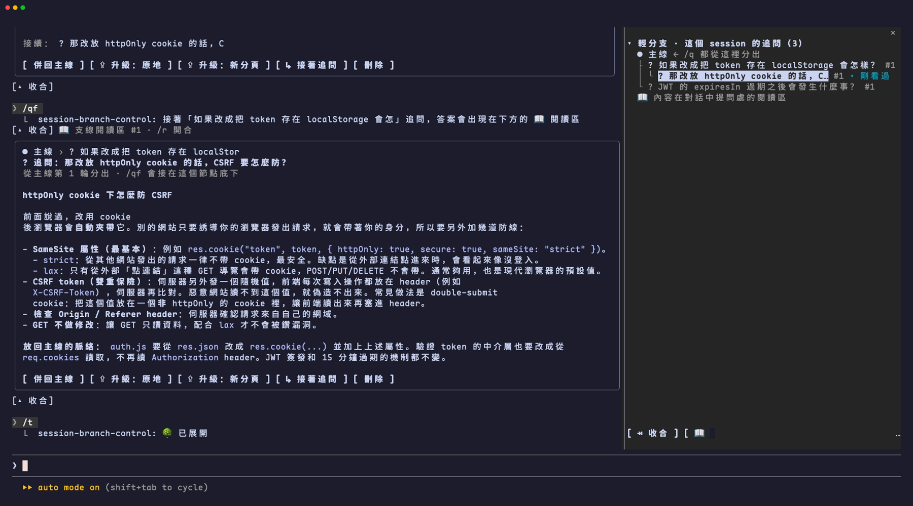
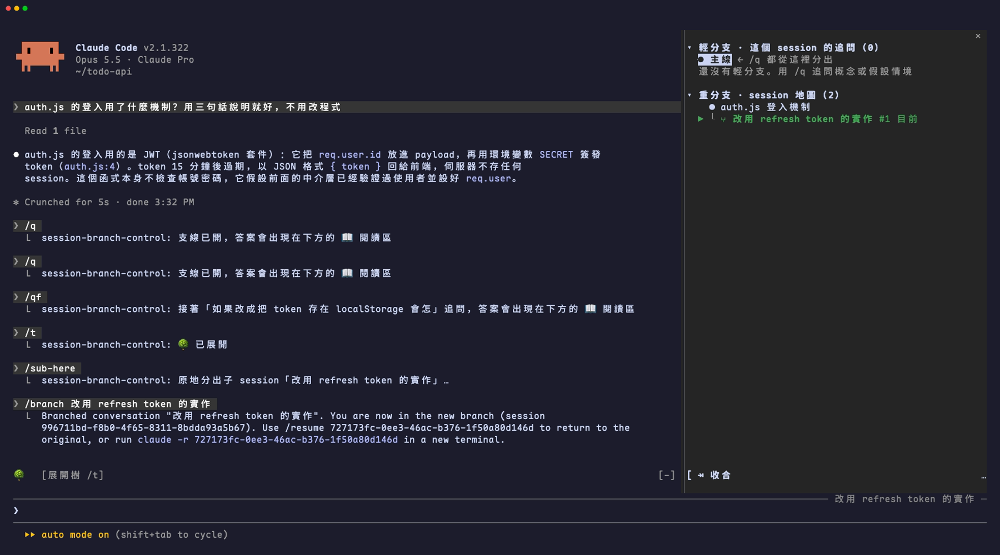

# session-branch-control

**讓 Claude Code 的對話「主線不偏題、支線不遺失」。**

和 Agent 長時間協作時，常常會冒出一個小疑問：「這個概念是什麼？」「如果改成另一種做法會怎樣？」
直接在主線問，問答就會混進 Context：主線被稀釋、偏題，Agent 也開始分心。
session-branch-control 讓你**開一條支線去問**，答案只顯示在閱讀區、不寫回主線；問出結論後，可以**併回主線**，或**升級成能使用工具的子 session** 繼續深入。



---

## 特色

### 1. `/q` 開輕支線：帶著主線脈絡回答，但不污染主線

輸入 `/q <問題>`，支線會帶著主線的完整脈絡作答（沿用主線的 prompt cache，又快又省），答案顯示在對話下方的 📖 **支線閱讀區**。
主線完全不知道你問過；主線還在回覆時也能直接送出 `/q`，不用排隊、也不會打斷主線。



### 2. 🌳 脈絡樹：每個疑問都有位置，隨時回去看

`/qf` 可以接著某條支線繼續追問，形成一條推演鏈。所有支線都列在右側的 🌳 脈絡樹，點一下節點，畫面就會捲回當初提問的位置。



### 3. 併回主線，或升級成子 session

在閱讀區按一下按鈕：

| 按鈕 | 作用 |
|---|---|
| **併回主線** | 把支線的結論寫進主線歷史，主線下一輪就會讀到（不觸發新的一輪、不讓快取失效） |
| **⇪ 升級：原地／新分頁** | 把支線變成真正的子 session，能讀檔、改程式、跑指令 |
| **↳ 接著追問** | 在這條支線底下繼續問 |

### 4. 🗺 Session 地圖：像瀏覽器分頁一樣管理分枝

`/sub`、`/sub-here` 可以從目前的 session 分出子 session；所有分枝的父子關係都畫在同一張地圖上，每個分頁都看得到。可以一鍵原地切換、開在新分頁，或把另一個 session 多出來的對話**併入**目前的 session。



---

## 30 秒上手

```text
> 先在主線正常聊一輪

/q CRDT 是什麼                    # 開一條輕支線，答案出現在閱讀區
/q 如果改用 JWT 會怎樣            # 換個前提推演看看
/qf 那 refresh token 要放哪？     # 接著上一條支線追問
/t                                # 開合 🌳 脈絡樹
/r                                # 開合閱讀區（收合時捲回原本讀到的地方）
/sub 試試別的資料庫               # 分出子 session，開在新分頁
```

| 指令 | 作用 |
|---|---|
| `/q <問題>` | 開輕支線：概念說明，或「如果改成…會怎樣」的推演 |
| `/qf <問題>` | 接著選中的（或最後看過的）支線追問 |
| `/t`／`/tree` | 開合脈絡樹面板／打開並聚焦 |
| `/r` | 開合最後看的閱讀區 |
| `/map` | 開合面板裡的 Session 地圖 |
| `/up`、`/up-tab` | 把選中的輕支線升級成子 session（原地／新分頁） |
| `/sub [標題]`、`/sub-here [標題]` | 從目前 session 分出子 session（新分頁／原地） |
| `/merge <id>` | 把地圖上另一個 session 多出來的對話併入目前 session |

完整說明見 👉 **[使用者手冊](docs/使用者手冊.md)**。

---

## 安裝

需要支援 plugin mod API 的 Claude Code（開發與測試環境：v2.1.322）。

```bash
claude plugin marketplace add ayii0111/session-branch-control
claude plugin install session-branch-control@session-branch-control
```

或在 Claude Code 裡執行：

```text
/plugin marketplace add ayii0111/session-branch-control
/plugin install session-branch-control@session-branch-control
/reload-plugins
```

移除：

```bash
claude plugin uninstall session-branch-control@session-branch-control
```

> - 按鈕要在全螢幕版面（`CLAUDE_CODE_NO_FLICKER=1`）才點得到；指令在任何版面都能用。
> - 終端機寬度 144 欄以上時，脈絡樹面板才會自動打開，窄的話用 `/tree`。
> - 「開在新分頁」需要在 Orca 終端機裡執行；不在 Orca 時，會把啟動指令複製到剪貼簿。

---

## 運作方式

| 功能 | 做法 |
|---|---|
| 輕支線問答 | `$.model.fork`：帶著主線完整脈絡、不使用工具、答案不寫回主線，並沿用主線的 prompt cache |
| 支線閱讀區 | 每條支線一列 `$.ui.place`，固定在提問的位置；`UserMessage`／`AssistantMessage` 的 render hook 記下畫面上緣是哪則訊息，用 `$.ui.scroll` 跳過去、再捲回原處 |
| 併回主線 | `$.session.append` 在歷史最後面加一筆隱藏紀錄，不觸發新的一輪；同時把問答插進 session 紀錄檔，重新載入後就像一般對話 |
| 升級成子 session | 照 `--fork-session` 的做法寫出子 session 的 `.jsonl`（中繼列＋壓縮邊界後的訊息鏈），再接上支線問答，接著 `/resume` 或在新分頁 `claude --resume`；寫不出來時自動退回 `/branch` |
| 併入另一個 session | fork 會沿用訊息 uuid，所以從對方路徑上「最後一則兩邊都有的訊息」之後，就是要補的部分；地圖記住併到哪裡，下次只補新增的 |
| 改寫執行中的紀錄檔 | 執行中的 cc 不會重讀檔案，所以在 `turn.complete` 與 `session.end` 時再修補一次串接；改寫前後各讀一次檔，期間被寫入就重來 |
| Session 地圖 | 每個專案一個 JSON（`~/.claude/session-branch-control/`），所有分頁共用，每 8 秒同步 |

```text
hooks/
├── register.tsx   指令、面板、輕支線、升級／分出流程
├── transcript.ts  讀寫 session 紀錄檔、計算提問序號、寫出子 session
├── merge.ts       併入另一個 session 時的比對與紀錄內容
├── splice.ts      把併回／併入的對話寫進紀錄檔，並修補之後的串接
└── graph.ts       地圖檔讀寫、Orca 分頁操作
tests/
└── branch.test.tsx
```

## 開發

```bash
claude --plugin-dir .            # 載入本 plugin 啟動（先移除已安裝版，避免重複載入）
claude plugin validate .         # 驗證
claude plugin test .             # 測試
npx -p typescript tsc -p .       # 型別檢查
```
